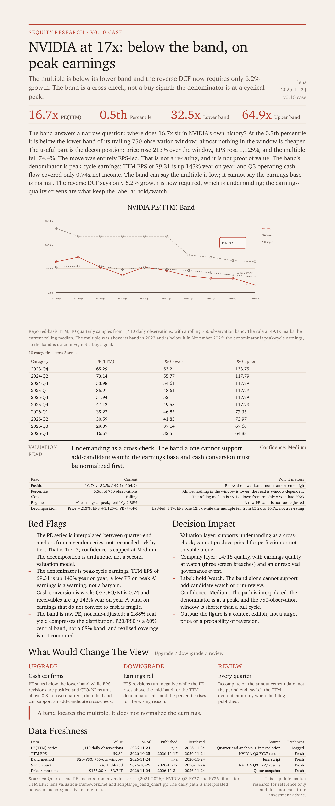
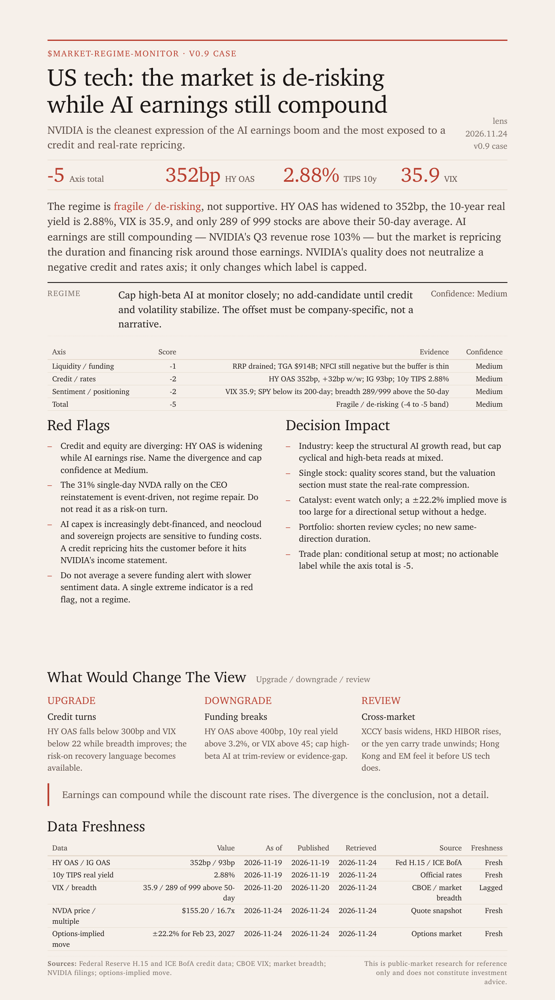
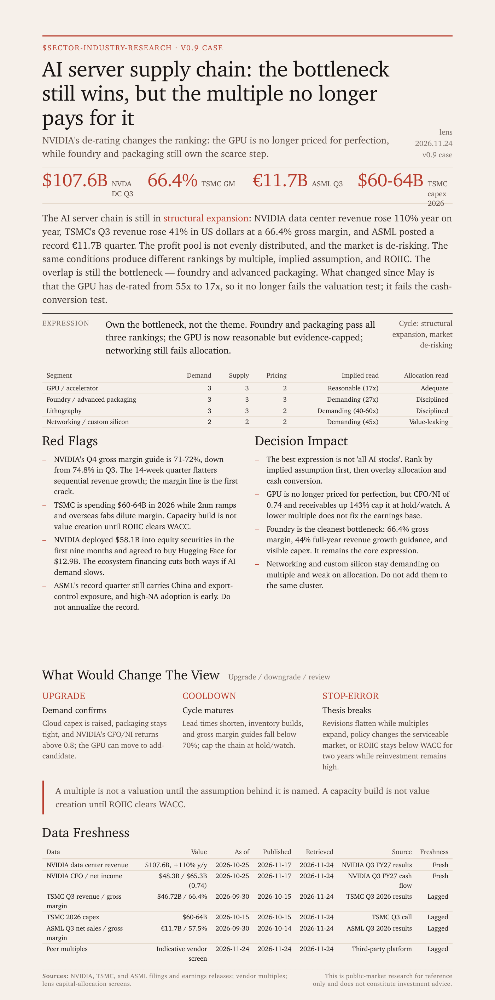
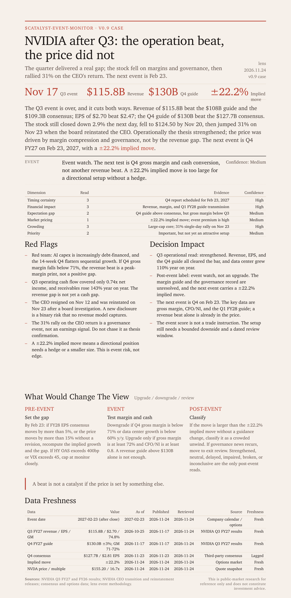
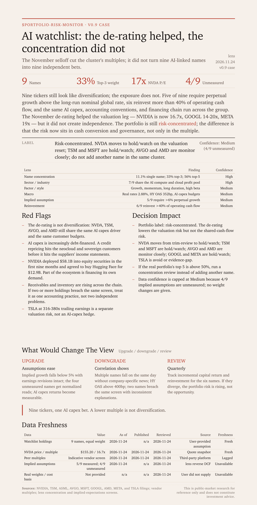
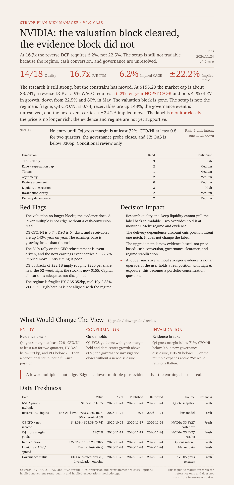

<p></p>

# lens

[中文文档](README.zh-CN.md)

lens turns public filings and market prices into a research label an agent can defend: what the price implies, whether the earnings are real, and what the evidence allows.

Six skills share one reference layer — market regime, sector, company, catalyst, portfolio, and trade planning. Every answer ends with one label, the single constraint that binds it, and the date it must be reviewed.

Repository: https://github.com/taoquo/marketlens-skills

## Contents

- [Skills](#skills)
- [Installation](#installation)
- [Usage](#usage)
- [Shared Contract](#shared-contract)
- [Data Discipline](#data-discipline)
- [Cross-Cutting Coverage](#cross-cutting-coverage)
- [Decision Chain](#decision-chain)
- [Examples](#examples)
- [Validation](#validation)
- [Disclaimer](#disclaimer)

## Skills

| Skill | Purpose |
|---|---|
| `equity-research` | Equity research for US, Hong Kong, and A-share listed companies, covering quality scoring, earnings-quality screens, fundamentals, implied-expectation valuation, historical valuation bands, moat, regional disclosures, red flags, and data freshness. |
| `market-regime-monitor` | Market regime monitoring across liquidity, sentiment, positioning, valuation crowding, scoring confidence, risk-budget impact, and cross-market risk transmission. |
| `sector-industry-research` | Sector and industry research across cycle stage, supply-demand, value chains, policy/technology shifts, peer structure, trade expression, and listed-company read-through. |
| `catalyst-event-monitor` | Event-driven research for upcoming catalysts, expectation gaps, market pricing, trade setup, scenario paths, pre-event watch data, and post-event thesis updates. |
| `portfolio-risk-monitor` | Portfolio and watchlist risk review across concentration, quantitative risk snapshots, exposures, priority ranking, drawdown scenarios, and rebalance watch signals. |
| `trade-plan-risk-manager` | Converts market, sector, stock, catalyst, and portfolio research into non-personalized conditional trade plans with setup quality, risk triggers, execution checks, and post-trade review. |

## Installation

Install from the open-source repository:

```bash
npx skills add https://github.com/taoquo/marketlens-skills --all
```

Or clone and link/copy the skill directories into a Codex project. Every skill loads shared rules through `../references/...`, so the top-level `references/` directory must sit next to the skill directories:

```bash
git clone https://github.com/taoquo/marketlens-skills.git
cd marketlens-skills

mkdir -p your-project/.codex/skills

# Option A: symlink for local development
for skill in */SKILL.md; do
  ln -s "$PWD/${skill%/SKILL.md}" "your-project/.codex/skills/${skill%/SKILL.md}"
done
ln -s "$PWD/references" your-project/.codex/skills/references

# Option B: copy for a standalone project
for skill in */SKILL.md; do
  cp -R "${skill%/SKILL.md}" your-project/.codex/skills/
done
cp -R references your-project/.codex/skills/
```

Build distributable `.skill` packages from a clone:

```bash
bash scripts/build-skills.sh
ls dist/*.skill
```

## Usage

Example prompts:

```text
Use $equity-research to analyze NVIDIA's latest annual results and valuation.
Use $equity-research to review Tencent's long-term quality and key risks.
Use $market-regime-monitor to assess whether the US equity market is crowded.
Use $market-regime-monitor to assess how current liquidity affects Hong Kong and A-share markets.
Use $sector-industry-research to analyze an industry cycle and key listed-company beneficiaries.
Use $sector-industry-research to compare an export manufacturing value chain across China and global peers.
Use $catalyst-event-monitor to map the next 12 weeks of events that could change a company's thesis.
Use $catalyst-event-monitor to review whether a product launch strengthened or weakened the thesis.
Use $portfolio-risk-monitor to review a watchlist for concentration, shared risk drivers, and priority names.
Use $portfolio-risk-monitor to identify which holdings belong in add-candidate, trim-review, or exit-review buckets.
Use $trade-plan-risk-manager to convert a stock thesis into a conditional trade plan with entry, invalidation, risk unit, and review triggers.
Use $trade-plan-risk-manager to review whether a completed trade was a thesis error, timing error, risk framing error, or execution error.
```

## Shared Contract

`references/skill-contract.md` holds the operating rules every skill inherits: public-market research only, no personalized advice, the mandatory shared routes (the contract plus four references), evidence-tier discipline, conclusion-gate behavior, the three timestamps and five freshness grades, and the six mandatory output blocks in order. The review gate separates author, reviewer, reviser, and publisher, runs a red-team pass for labels stronger than `hold/watch`, and requires measurable `What Would Change The View` triggers. It also defines the research state card that carries one question, date, mode, layer reads, label, binding constraint, freshness, and source-pool IDs across a multi-skill run. Each `SKILL.md` keeps only its domain-specific Core Rule, evidence sources, gates, degradation table, workflow, and output template.

`VERSION` is the single release source. `scripts/validate-skills.sh` checks that every `SKILL.md`, `VERSION`, and the latest `CHANGELOG.md` heading agree, and that README example coverage and image paths match `examples/`.

## Data Discipline

`references/data-discipline.md` holds the rules every skill inherits. Each `SKILL.md` adds only what is specific to its domain:

- official and primary sources first, under one shared three-tier evidence model;
- a source pool with stable IDs and a claim-to-source map; duplicate vendor copies of one filing are not counted as independent sources;
- fact, estimate, and opinion separated at the sentence level, with the source next to the claim;
- `as_of`, `published_at`, and `retrieved_at` recorded separately, never collapsed;
- a closed set of freshness grades: `Fresh`, `Lagged`, `Stale`, `Undated`, `Unavailable`;
- a core figure check with original wording, unit, period, cross-check, and one of four treatments;
- silent-failure checks for successful-looking but wrong data: error payloads, empty-list ambiguity, unit scaling, identifier drift, field drift, placeholder rows, and stale endpoints;
- unit, currency, accounting-standard, and fiscal-calendar labelling before any cross-market comparison;
- user input classified as plan parameter, fact claim, or preference, with consistency checks before use;
- missing data marked unavailable and treated as a confidence limit, never as a directional signal.

Every skill also carries a degradation table mapping each missing or stale input to the required handling, so a data gap changes the output in a defined way instead of being noted and ignored.

A skill has no memory between sessions, so `references/review-and-calibration.md` defines a `research-log/` append-only record. A call is written there when it is made, which is what lets the 1-week, 1-month, and 3-month review cadence actually close. The directory is gitignored and never created without asking first. The same file defines `Thesis Decay`: a label that has not been reconfirmed is not intact by default, and price moving toward the thesis without fundamental follow-through reduces confidence rather than raising it. It also defines the pre-publication review gate: six content dimensions, `PASS` or `REVISE`, seven blocking conditions, separated author/reviewer/reviser/publisher passes, a red-team pass for strong labels, and bounded revision rounds before an output is presented as complete.

## Cross-Cutting Coverage

Six shared references are not owned by any one skill, because they change the conclusion in more than one layer. `references/skill-routing.md` lists the trigger for each:

- `references/implied-expectations.md` inverts the valuation question from what a company is worth to what its price requires. It splits enterprise value into the no-growth and growth components, runs a reverse DCF that solves for exactly one variable and translates it into an absolute quantity, reads each common multiple as an implied statement, and names what to solve for when a DCF does not fit the business model. Margin of safety is expressed as the distance between the implied assumption and the historical record, not as a discount to a computed fair value.
- `references/earnings-quality-screens.md` converts the qualitative red-flag list into computed ratios with thresholds. Cash conversion, accrual ratios, working-capital versus revenue growth, cost capitalization, and balance-sheet integrity are all computable from one filing plus the prior-year comparative. The breach count maps to a confidence cap and a label cap, and a sector table states which screens do not apply and what replaces them.
- `references/credit-and-cross-asset.md` treats equity as the junior claim. Market-level credit spreads, real yields, breakevens, term premium, and funding basis feed the regime read; maturity ladders, covenant headroom, and rating trajectory feed single-name work. For property, financials, capital-intensive, and pre-profit sectors, an equity conclusion without a credit read is capped rather than merely flagged.
- `references/base-rates.md` requires a reference class and its historical rate before any probability, likelihood word, or scenario weight. It covers approval rates, deal completion, guidance reliability, cycle duration, margin recovery, turnarounds, capacity cycles, and post-event drift, and keeps the unadjusted rate visible next to the adjusted estimate.
- `references/short-and-relative-value.md` adds the short side and the relative-value pair as first-class reads, so a confirmed red flag becomes a research object rather than only a confidence deduction. Short-side language requires verified borrow, float, and crowding data; without them the read stays `avoid only`.
- `references/capital-allocation-record.md` measures what management did with the cash. A five-year sources-and-uses ledger has to reconcile before any judgement is made, then twelve return screens measure what each destination earned, including ROIIC on both a with-goodwill and an ex-goodwill basis over two windows, cumulative impairment against cumulative acquisition consideration, post-deal ROIC change, buyback timing as a percentile of the company's own trading range, buyback spend against SBC, and net dilution. Seven further screens measure whether stated intentions were met, starting from the guidance hit rate and whether the incentive plan pays for capital efficiency at all. The aggregate read sets the reinvestment credit the valuation is allowed to take: historical ROIIC when `disciplined`, WACC when `adequate`, below WACC when `value-leaking`, and a no-growth anchor when `destructive`.

`references/skill-routing.md` also carries an `Out Of Scope` table. Crypto, standalone FX, commodity futures, bond selection, options strategy, convertibles, private companies, fund selection, portfolio optimization, tax and legal advice, ESG scoring, intraday execution, and personal financial planning are outside coverage. Each row names the in-scope adjacent read.

## Decision Chain

Each skill owns one layer of the research process. `references/skill-routing.md` holds the ownership table, and `references/scoring-standard.md` holds the shared scoring and research-label rules, the mapping from each layer to the shared labels, and the binding chain constraints. When multiple skills apply, use the full chain:

```text
Market Regime -> Sector / Industry Setup -> Company Quality And Valuation -> Catalyst / Timing -> Portfolio Role And Risk -> Research Label -> Conditional Trade Plan And Risk Review
```

### Research Desk Modes

`references/skill-routing.md` defines four modes for multi-skill requests:

| Mode | Use when | Layer order |
|---|---|---|
| `quick` | One layer owns the question | The owning skill only |
| `full` | The question needs a research label across the chain | Regime -> sector -> company -> catalyst -> portfolio -> label |
| `event` | A dated event is the decision point | Catalyst -> company -> trade plan |
| `portfolio` | The question is exposure, concentration, or priority | Portfolio -> regime -> company |

Each mode names its skip rule and missing-layer cap; the run still ends with one label, one binding constraint, and one review date. The modes are a routing aid, not a new skill or runtime.

Release-by-release changes are tracked in [CHANGELOG.md](CHANGELOG.md).

## Examples

The `examples/` folder contains seven English Folio-typeset validation cases: the six v0.9 cases, rebuilt with NVIDIA as the core case, plus a v0.10 historical valuation-band case. Each case exercises the current gates: what the price implies, whether the reported earnings survive the screens, where the cash actually went, and which label the answer is allowed to carry.

Previews are collapsed because the continuous PNGs are tall. Open the PDF for A4 pagination or the HTML for the source.

### Case Index

Coverage is at least one case per skill: six skills and seven cases, with a second `equity-research` case for the historical valuation band.

| Skill | Case | Pages | Files |
|---|---|---:|---|
| `equity-research` | `lens-v09-equity-research-nvda` | 4 | [HTML](examples/lens-v09-equity-research-nvda.html) · [PDF](examples/lens-v09-equity-research-nvda.pdf) · [PNG](examples/lens-v09-equity-research-nvda.png) |
| `equity-research` | `lens-v010-valuation-band-nvda` | 2 | [HTML](examples/lens-v010-valuation-band-nvda.html) · [PDF](examples/lens-v010-valuation-band-nvda.pdf) · [PNG](examples/lens-v010-valuation-band-nvda.png) |
| `market-regime-monitor` | `lens-v09-market-regime-nvda` | 2 | [HTML](examples/lens-v09-market-regime-nvda.html) · [PDF](examples/lens-v09-market-regime-nvda.pdf) · [PNG](examples/lens-v09-market-regime-nvda.png) |
| `sector-industry-research` | `lens-v09-sector-ai-server` | 2 | [HTML](examples/lens-v09-sector-ai-server.html) · [PDF](examples/lens-v09-sector-ai-server.pdf) · [PNG](examples/lens-v09-sector-ai-server.png) |
| `catalyst-event-monitor` | `lens-v09-catalyst-nvda-earnings` | 2 | [HTML](examples/lens-v09-catalyst-nvda-earnings.html) · [PDF](examples/lens-v09-catalyst-nvda-earnings.pdf) · [PNG](examples/lens-v09-catalyst-nvda-earnings.png) |
| `portfolio-risk-monitor` | `lens-v09-portfolio-ai-nvda` | 2 | [HTML](examples/lens-v09-portfolio-ai-nvda.html) · [PDF](examples/lens-v09-portfolio-ai-nvda.pdf) · [PNG](examples/lens-v09-portfolio-ai-nvda.png) |
| `trade-plan-risk-manager` | `lens-v09-trade-plan-nvda` | 2 | [HTML](examples/lens-v09-trade-plan-nvda.html) · [PDF](examples/lens-v09-trade-plan-nvda.pdf) · [PNG](examples/lens-v09-trade-plan-nvda.png) |

### Case Previews

<details>
<summary><strong>equity-research · NVIDIA quality case</strong> — 4 pages</summary>

NVIDIA at 14/18 quality across six dimensions: earnings quality at watch on three screen breaches, an unresolved governance event, and a reverse DCF that now requires only 6.2 percent growth. The label stays hold/watch because the evidence, not the price, is the constraint.


</details>

<details>
<summary><strong>equity-research · NVIDIA PE(TTM) band</strong> — 2 pages</summary>

NVIDIA at 16.7x sits at the 0.5th percentile of its own 1,410-observation history, measured on a rolling 750-observation window, below a 32.5x lower band and a 64.9x upper band. The move is EPS-led: price +213%, EPS +1,125%, multiple -74.4%. The band remains a cross-check rather than a label, because the TTM denominator is peak-cycle earnings. Illustrative data.



</details>

<details>
<summary><strong>market-regime-monitor · US technology regime</strong> — 2 pages</summary>

US technology-stock regime on three axes scores -5: HY OAS at 352bp, a 2.88 percent 10-year real yield, and VIX at 35.9 put the regime at fragile / de-risking, which caps high-beta AI at monitor closely even while NVIDIA's earnings still compound.



</details>

<details>
<summary><strong>sector-industry-research · AI server supply chain</strong> — 2 pages</summary>

The AI server supply chain ranked three times: by multiple, by implied assumption, and by return on incremental capital. NVIDIA's de-rating to 17x makes the GPU reasonable but cash-capped; foundry and advanced packaging still own the scarce step.



</details>

<details>
<summary><strong>catalyst-event-monitor · NVIDIA earnings</strong> — 2 pages</summary>

NVIDIA's Q3 delivered a real gap: revenue of $115.8B and a $130B Q4 guide, but the stock fell on margin and governance, then rallied 31 percent on the CEO's return. The next event on Feb 23 carries a ±22.2 percent implied move, so the label stays event watch.



</details>

<details>
<summary><strong>portfolio-risk-monitor · AI watchlist</strong> — 2 pages</summary>

An equal-weight AI watchlist where nine tickers still resolve into one duration bet, one shared accounting practice, and one reinvestment dependence. The November de-rating helped the valuation leg but not the concentration: 33 percent in the top three and 4 of 9 implied assumptions unmeasured.



</details>

<details>
<summary><strong>trade-plan-risk-manager · NVIDIA plan</strong> — 2 pages</summary>

The NVIDIA plan stays at monitor closely for the opposite reason than in May: the valuation block has cleared, but cash conversion, an unresolved governance event, and a fragile regime keep the setup conditional and position intent one notch down.



</details>

### Output And Coverage

Every case carries the six mandatory blocks: `Red Flags`, `Decision Impact`, `What Would Change The View`, `Data Freshness`, `Evidence Sources`, and `Disclaimer`. In the typeset cases the last two are carried by the footer `Sources` list and the closing disclaimer line rather than by their own headings. Each `Data Freshness` table records the three timestamps from `references/data-discipline.md` and grades every input with one of the five closed grades `Fresh` / `Lagged` / `Stale` / `Undated` / `Unavailable`, so the confidence cap in each case is traceable to a named missing or lagged input. Scored outputs add a `Score Summary` table; `trade-plan-risk-manager` uses `Setup Quality` instead, as allowed by `references/scoring-standard.md`. They are output-format previews and do not constitute investment advice.

v0.9 rebuilt the examples in English; v0.10 added the historical valuation band method and a seventh case; v0.11 added the research quality layer; v0.12 adds adversarial review, falsifiable triggers, silent-failure checks, and a behavioral verification record. The v0.10 band case still shows the EPS/PE decomposition, and the existing cases remain current.

### Valuation Band Guide

The method, data format, command-line utility, and interpretation are documented in the [Valuation Band Guide](docs/valuation-band.md). The case is a Folio `line-chart` drawing; the local chart utility remains the dependency-free standalone fallback:

```bash
python3 scripts/pe_band_chart.py \
  --input examples/data/nvda-pe-ttm-illustrative.csv \
  --output pe-band.svg \
  --table-output pe-band.csv \
  --summary-json summary.json
```

## Validation

```bash
# structure, frontmatter, reference routing, shared contract, output block order,
# version consistency, and example coverage
bash scripts/validate-skills.sh

# rebuild packages, then require dist/*.skill to match the working tree byte for byte
bash scripts/build-skills.sh
REQUIRE_DIST=1 bash scripts/validate-skills.sh
```

Skills are discovered from the directory layout, so a new skill needs no script or CI edit. GitHub Actions runs the same three commands on every push and pull request. Structural validation does not test behavior. [docs/verification.md](docs/verification.md) records the behavioral scenarios for label caps, source-pool handling, red-team review, falsifiable triggers, and silent-failure checks, including what has not been run.

## Disclaimer

These skills are for research and educational use only. They do not provide personalized investment, legal, tax, or financial advice. Public-market investing involves risk, including loss of principal.
